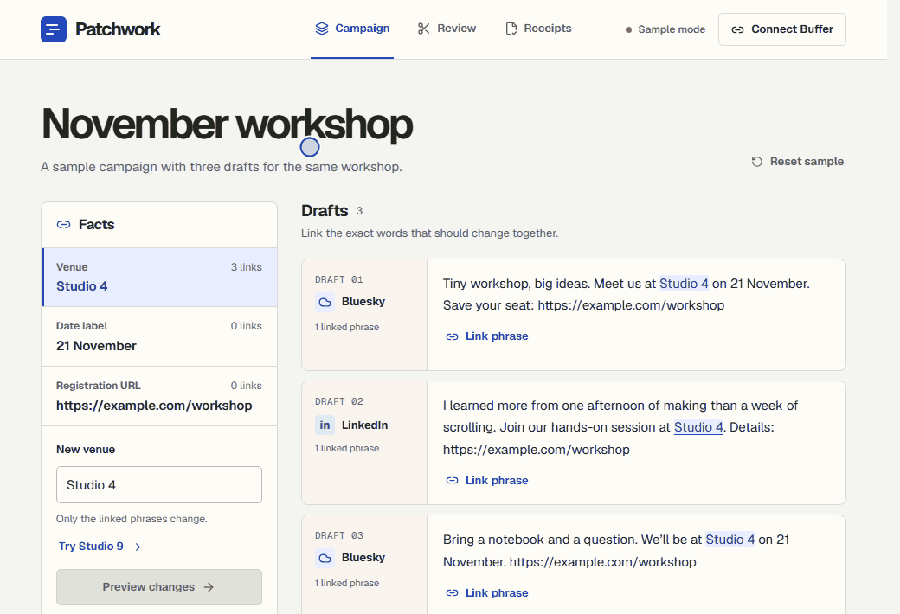
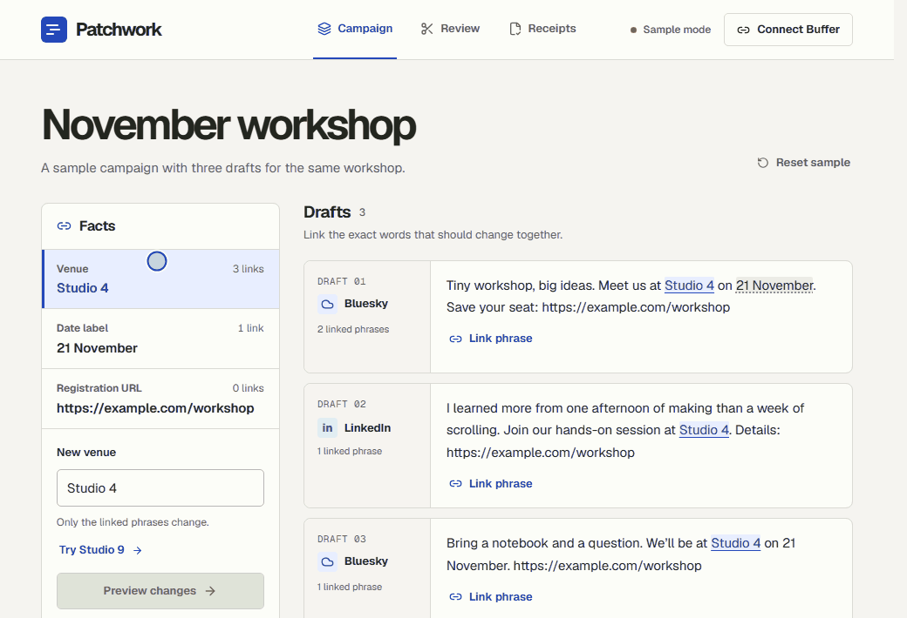
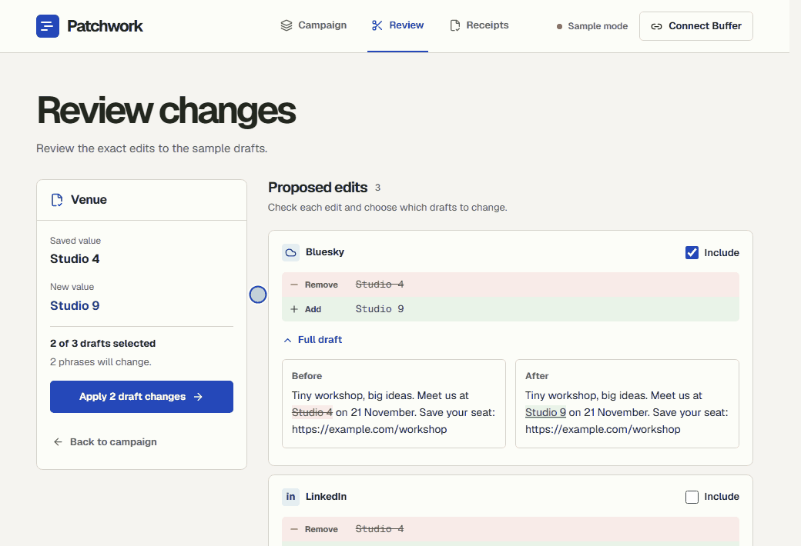

# Patchwork

Patchwork is a correction desk for Buffer drafts. When a workshop moves from Studio 4 to Studio 9, link the venue in each draft, check the proposed edits, and send only the approved changes back to Buffer.

[Open Patchwork](https://patchwork-workbench.vercel.app/) · [Project showcase](https://patchwork-showcase.vercel.app/) · [Privacy policy](https://patchwork-workbench.vercel.app/privacy)

The public workbench opens with fictional drafts. The hosted Buffer connection is available to the configured test operator.

## How it works

The recordings use Patchwork’s built-in sample campaign.

### Link a phrase

Choose a fact, then select the exact words in the draft. Here, `21 November` becomes a linked date label.



### Review an edit

The sample already links the venue. Change it to `Studio 9`, open the full draft to check the edit in context, and choose which drafts to include.



### Apply and verify

Confirm the selected batch. The receipts show the result for each draft.



## Run locally

Use Node.js 24.2 or later and npm 11 or later.

```sh
npm ci
npm run dev
```

Open [localhost:3000](http://localhost:3000) to try the sample. It starts with three fictional drafts and needs no credentials. For a connected workspace, follow the [Buffer OAuth setup](docs/development/getting-started.md#configure-an-approved-buffer-client).

## Draft eligibility and receipts

Patchwork works with eligible, unscheduled plain-text Buffer drafts. Before sending an edit, it checks the draft text, status, and edit permissions again. It marks a live edit **Verified** after Buffer confirms the edit and the saved text matches the review. Buffer does not document a version check on `editPost`, so an edit made in Buffer can still land between the check and the write.

The local workbench changed the first of two identical phrases in a live Bluesky draft and verified the saved text in Buffer. The Vercel workbench also completed Buffer OAuth and read that draft. Live editing on a second channel is still unverified. [Test evidence](docs/evidence/README.md)

## Development

The Next.js workbench uses a deterministic TypeScript patch planner. The same planner powers the static showcase.

- Run `npm test` and `npm run typecheck`. For the browser suite, install Chromium with `npx playwright install chromium`, then run `npm run test:e2e`.
- Read about the [product scope](docs/product/specification.md), [write protocol](docs/engineering/architecture.md), and [data handling](docs/engineering/security-and-privacy.md).
- See [getting started](docs/development/getting-started.md) for deployment and [contributing](CONTRIBUTING.md) for repository conventions.
